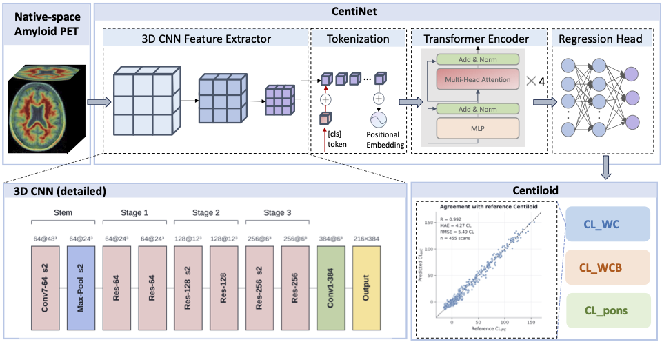

# CentiNet: one-step Centiloid quantification from native-space amyloid PET

End-to-end deep learning that maps a **native-space** 18F-florbetapir PET volume directly to continuous Centiloid (CL) values, with no MRI, no spatial normalization and no reference-region masking anywhere in the input path. 

One shared encoder regresses three targets jointly, namely `CL_pons`, `CL_WC` (whole cerebellum) and `CL_WCB` (whole cerebellum + brainstem). `CL_WC` is the primary target for model selection.

Ground-truth Centiloid values come from an in-house NOS_PETquan pipeline (developed based on GAAIN). The code, the released weights and the inference script are provided for research use only.

> **Paper:** manuscript in preparation — citation will be added on publication ·
> **Weights:** see [Pretrained weights](#pretrained-weights)
> 

## Contents

- [Quick start: inference](#quick-start-inference)
- [Pretrained weights](#pretrained-weights)
- [Installation](#installation)
- [Data layout](#data-layout)
- [Reproducing the paper](#reproducing-the-paper)
- [Models](#models)
- [Design guards against leakage](#design-guards-against-leakage)
- [Repository layout](#repository-layout)
- [Citation and acknowledgements](#citation-and-acknowledgements)

## Quick start: inference

```bash
pip install -r requirements.txt
python predict.py --ckpt weights/resnet_transformer_hybrid.pt \
    /path/to/AMY_AV45_PET.nii --out predictions.csv
```

`predict.py` reorients each volume to RAS, resamples to 2 mm isotropic,
crops a 96³ window around the foreground bounding box, divides by the 95th
percentile of the volume's own foreground voxels, and returns the three CL
values in Centiloid units. Inputs should be native-space PET volumes of the
ADNI "Coreg, Avg, Std Img and Vox Siz, Uniform 6mm Res" type (or equivalently
smoothed, attenuation-corrected static images). No MRI is needed. A GPU is
optional; CPU inference takes a few seconds per scan.

## Pretrained weights

| file | model | training | test CL_WC MAE | notes |
|---|---|---|---|---|
| `resnet_transformer_hybrid.pt` | `resnet_transformer_hybrid` | default protocol; seed selected by **validation** CL_WC MAE (best of 10) | 4.35 CL | canonical released checkpoint |

Across all 10 seeds the test CL_WC MAE is **4.32 ± 0.10**; the released seed was
chosen on the validation split only, so its test number is an unbiased estimate.
Every checkpoint ships with a `.json` sidecar (architecture, preprocessing
parameters, target statistics, SHA-256).

Weights are **not** stored in git. Download them from the GitHub release
page (<https://github.com/Nancy-Zhang-0/CentiNet/releases/latest>) into
`weights/`, then verify the SHA-256
listed in the `.json` sidecar next to each file. Each release checkpoint is
self-contained: it carries the model name and kwargs, the preprocessing
parameters and the train-split target statistics needed to convert network
outputs back to Centiloid. `weights/target_stats.json` holds the same
statistics for reference.

To package your own run the same way:

```bash
python tools/export_checkpoint.py --run_dir runs/<run_name> --out weights/<name>.pt
```

## Installation

Python 3.11, PyTorch 2.5.1 (CUDA 12.4 was used for training), MONAI 1.4.

```bash
conda create -n deep-amyloid python=3.11
conda activate deep-amyloid
pip install -r requirements.txt
python -m pytest tests -q        # split integrity, model shapes, metric values
```

## Data layout

Training expects the ADNI PET data to be organised as

```
<pet_root>/
  <subject_id>/                                   e.g. 002_S_0413
    AV45_Coreg,_Avg,_Std_Img_and_Vox_Siz,_Uniform_6mm_Res/
      <YYYY-MM-DD>_.../processed/
        AMY_AV45_PET.nii                          native-space PET (NIfTI)
        AMY_AV45_Centiloid.csv                    columns ID, CG, PONS, WC, WCB
    FBB_Coreg,.../<date>/processed/AMY_FBB_PET.nii, AMY_FBB_Centiloid.csv
```

Set `paths.pet_root` in `configs/default.yaml` (or pass
`--set paths.pet_root=/your/path`). The folder prefix (`AV45`, `FBB`) selects
the tracer; AV45-Early and tau series are skipped. Only the three CL columns
are used as targets.

ADNI data cannot be redistributed. Apply at
<https://adni.loni.usc.edu/data-samples/access-data/>. The label CSVs were
produced by our in-house Centiloid pipeline.

## Reproducing the paper

### Cohort and preprocessing

```bash
python scripts/00_build_labels.py     # scan the ADNI tree -> data/labels.csv, data/pet_files.csv
python scripts/01_make_manifest.py    # join + FOV QC + subject-level split (seed 42)
python scripts/02_preprocess.py       # RAS -> 2 mm -> 96^3 crop -> p95 norm -> float16 cache
```

Two inputs used for the paper cohort are not part of this repository:

- `paths.group_csv`, the ADNI subject table (Subject, Sex, Age, Group). It only
  feeds Table 1 and the stratified analyses; leave it empty to skip them.
- `paths.outlier_csv`, a scan-level exclusion list (140 AV45 scans flagged by
  biological-range, IQR and visual-QA criteria, approved by the supervising
  investigator). Without it, `01_make_manifest.py` prints
  `no outlier list applied` and the split will differ from the paper's.
  The list and the per-split subject IDs are available on request under the
  ADNI Data Use Agreement. _[or: provided as `docs/excluded_scans.csv`]_

The resulting split is summarised in [`docs/split_summary.md`](docs/split_summary.md)
(train 656 subjects / 1612 scans, val 92 / 222, test 185 / 455).

### Training protocol per architecture

`configs/default.yaml` is the shared base (AdamW, lr 1e-4, weight decay 0.05,
5 warm-up epochs then cosine, batch 8, SmoothL1 on standardised targets,
early stopping with patience 15 on validation CL_WC MAE, AMP). The epoch
budget differs per architecture; the exact commands used for every run in the
paper are:

| model | command |
|---|---|
| `resnet_transformer_hybrid` (main) | `python scripts/03_train.py --model resnet_transformer_hybrid --seed S` |
| `cnn_transformer_hybrid` | `python scripts/03_train.py --model cnn_transformer_hybrid --seed S` |
| `cnn_conv_control` | `python scripts/03_train.py --model cnn_conv_control --seed S` |
| `resnet3d_18`, `resnet3d_34` | `python scripts/03_train.py --model resnet3d_18 --seed S --set train.epochs=50` |
| `vit3d_small` | `python scripts/03_train.py --model vit3d_small --seed S --set train.epochs=150` (lr 5e-5) |
| `swinunetr_encoder` | `python scripts/03_train.py --model swinunetr_encoder --seed S --set train.epochs=150` (lr 5e-5) |
| `swinunetr_encoder` (CT-pretrained) | add `--pretrained_path data/pretrained/model_swinvit.pt` |

Seeds 0–9 were run for every architecture (`scripts/run_seed_study.sh`,
`scripts/run_swin_pretrained_seeds.sh`). `model_swinvit.pt` is the public
MONAI self-supervised Swin UNETR checkpoint from
<https://github.com/Project-MONAI/research-contributions/tree/main/SwinUNETR/Pretrain>.
Any config key can be overridden with `--set section.key=value`, for example
`--set train.model_kwargs.norm=gn` for the GroupNorm ablation.

### Evaluation and analyses

```bash
python scripts/04_evaluate.py --run_dir runs/<run>      # predictions, metrics, scatter + Bland-Altman
python scripts/05_summarize.py                          # results/summary.md over all runs
python scripts/16_seed_study_summary.py                 # mean ± sd over seeds -> results/seed_study.md
python scripts/09_tost.py                               # equivalence tests
python scripts/10_clinical_metrics.py                   # positivity at 20/24/30 CL
python scripts/11_stratified_robustness.py              # by diagnosis and CL interval
python scripts/12_longitudinal_rates.py                 # annual rate agreement, ICC
python scripts/13_calibration.py                        # raw vs post-hoc affine calibration
python scripts/14_table1.py                             # cohort table
python scripts/06_attention_map.py --run_dir runs/<hybrid run>   # CLS attention
python scripts/07_occlusion_map.py --run_dir runs/<run>          # occlusion sensitivity (any model)
python scripts/08_gradcam_map.py   --run_dir runs/<run>          # Grad-CAM on CNN features
python scripts/15_optuna_search.py --n_trials 24                 # HPO on validation MAE only
```


## Models

All models map `[B, 1, 96, 96, 96] → [B, 3]` through `encoder → feature →
Dropout → Linear`. Registry: `src/models.py::build_model`.

| name | description |
|---|---|
| `resnet_transformer_hybrid` | ResNet-18-style stem (3 stages, 64→256 channels, 6³ grid) → 1×1×1 projection to 384 → 4 pre-norm transformer layers (6 heads) → CLS token. Options: `norm` (bn/gn/in), `pool` (cls/cls+mean), `drop_path`. |
| `cnn_transformer_hybrid` | Plain 4-stage conv stem (32→384) → same transformer head. |
| `cnn_conv_control` | Parameter-matched control: same stem, transformer replaced by two 3³ conv blocks (no attention). |
| `resnet3d_10/18/34` | MedicalNet-style 3D ResNets, trained from scratch. |
| `vit3d_small` | 3D ViT, patch 16, dim 384, depth 8, fixed 3D sin-cos positions. |
| `swinunetr_encoder` | MONAI Swin UNETR encoder, global average pooling of the deepest map; optional CT self-supervised initialisation. |

## Design guards against leakage

- **Subject-level split**, computed once in step 1 (seed 42, stratified on
  baseline CL_WC bin × tracer set) and read from `data/manifest.csv`
  everywhere else. `tests/test_split.py` and an assertion in every training
  run check that no subject appears in two partitions.
- **No anatomical information in the input path.** Intensity normalisation
  divides by the p95 of the volume's own foreground voxels; no cerebellar,
  pontine or atlas region is used anywhere.
- **Target standardisation uses train-split statistics only**
  (`data/target_stats.json`); training aborts if that file no longer matches
  the current manifest.
- **Scale invariance.** Training applies random multiplicative intensity
  scaling in [0.5, 2.0] on top of affine, flip and noise augmentation.
- **FOV QC.** Scans in the lowest 5 % of inferior field-of-view coverage are
  flagged and excluded from all partitions.
- **HPO** (script 15) optimises validation MAE only; the test split is never
  read before final evaluation.

## Repository layout

```
configs/default.yaml      single config; every key overridable with --set
src/                      config, dataset + augmentation, preprocessing, split, models, metrics
scripts/00-16_*.py        pipeline steps in order (see above)
scripts/run_*.sh          multi-seed drivers used for the paper
predict.py                inference on new NIfTI volumes
tools/export_checkpoint.py  package a run into a release checkpoint
tests/                    pytest unit tests
weights/                  release checkpoints (downloaded) + target_stats.json
docs/                     split summary
```

Generated artefacts (`data/`, `runs/`, `runs_optuna/`) are git-ignored and
must never be committed because they contain ADNI-derived data.

## Citation and acknowledgements

The accompanying manuscript is in preparation; a citation (BibTeX) will be
added here on publication. Until then, please cite this repository by its URL
and commit hash.

Data collection and sharing for this project was funded by the Alzheimer's
Disease Neuroimaging Initiative (ADNI) (National Institutes of Health Grant
U01 AG024904) and DOD ADNI (Department of Defense award number
W81XWH-12-2-0012). ADNI is funded by the National Institute on Aging, the
National Institute of Biomedical Imaging and Bioengineering, and through
generous contributions from private partners listed at
<https://adni.loni.usc.edu/about/#fund-container>. Data used in preparation of
this work were obtained from the ADNI database (adni.loni.usc.edu); the ADNI
investigators contributed to the design and implementation of ADNI and/or
provided data but did not participate in analysis or writing of this work.
A complete listing of ADNI investigators can be found at
<https://adni.loni.usc.edu/wp-content/uploads/how_to_apply/ADNI_Acknowledgement_List.pdf>.

The Swin UNETR pretrained weights are from Tang et al., CVPR 2022
(Project-MONAI/research-contributions), Apache-2.0.

## License

Code: MIT (see `LICENSE`). Weights: research use only, see the note in
`LICENSE`.
